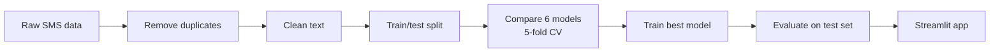

# SMS Spam Detection

[](https://github.com/harvik07/sms-spam-dete/actions/workflows/ci.yml)

Classifies text messages as spam or clean, and shows which words drove each verdict.
Includes a training pipeline, a Streamlit app, tests, and a GitHub Actions workflow.

## How it works



Text cleaning lowercases each message, keeps alphabetic words, removes stop words and
applies Porter stemming. TF-IDF sits inside the model pipeline, so it only learns from
training data. All models use their default settings, with no hyperparameter tuning.

## Results

The Support Vector Machine had the best cross-validated F1 score. On the held-out test
set of 1,032 messages:

| Metric    | Score  |
|-----------|--------|
| Accuracy  | 97.9%  |
| Precision | 99.1%  |
| Recall    | 84.0%  |
| F1 score  | 0.909  |

| Model                  | Mean CV F1 |
|------------------------|------------|
| Support Vector Machine | 0.892      |
| Random Forest          | 0.873      |
| Decision Tree          | 0.825      |
| Naive Bayes            | 0.819      |
| Logistic Regression    | 0.806      |
| K-Nearest Neighbors    | 0.462      |

## Run it

```bash
pip install -r requirements-dev.txt
```

```bash
python -m spam_detector.pipeline
```

```bash
streamlit run app.py
```

```bash
python -m pytest
```

## Run with Docker

```bash
docker compose up -d --build
```

| Service    | URL                   | Purpose                   |
|------------|-----------------------|---------------------------|
| App        | http://localhost:8501 | Streamlit interface       |
| Prometheus | http://localhost:9090 | Metrics and alerts        |
| Grafana    | http://localhost:3000 | Dashboard, `admin`/`admin` |

Open **SMS Spam Detector** in Grafana to see model scores, request counts, verdicts,
latency, spam score and message length. Model scores come from the test set at training
time, not live traffic, because live messages have no true labels. Set
`GRAFANA_ADMIN_PASSWORD` before exposing Grafana beyond your machine.

## Project layout

```
app.py              Streamlit app
spam_detector/      Data, preprocessing, models, evaluation, inference, metrics
ui/                 Page styling and HTML components
tests/              Unit and app tests
data/raw/           SMS Spam Collection dataset
models/             Trained pipeline and metrics
reports/            Model comparison and charts
monitoring/         Prometheus rules and Grafana dashboard
docs/               Step-by-step project workflow (PDF)
Dockerfile          App image
docker-compose.yml  App, Prometheus and Grafana stack
.github/workflows/  CI: tests, full training run, Docker stack check
```

## Dataset

[SMS Spam Collection](https://archive.ics.uci.edu/dataset/228/sms+spam+collection) from
the UCI Machine Learning Repository, by Tiago A. Almeida and José María Gómez Hidalgo.
It has 5,574 messages. Removing duplicates leaves 5,171, and dropping 14 with no usable
words leaves 5,157 for training and testing.

## Author

Harvik ([@harvik07](https://github.com/harvik07))
